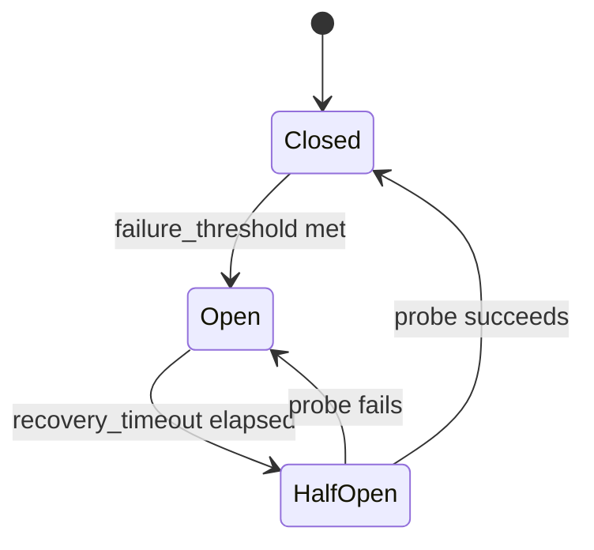

# ADR-0019: Circuit Breaker Middleware

## Status

Accepted

## Context

External API integrations are prone to transient and cascading failures. When
an external service experiences degradation or outage, a naive client that
keeps retrying requests can amplify the failure by overwhelming the failing
service with additional traffic. This creates a cascading effect that damages
both the target service's recovery prospects and the caller's own resource
consumption.

The **circuit breaker pattern** is a proven solution that:

- **Detects** repeated failures (threshold: N consecutive failures).
- **Stops** forwarding requests while the service is failing (circuit open).
- **Probes** for recovery after a timeout (half-open state).
- **Resumes** normal operation once a probe succeeds (circuit closed).

Without a circuit breaker, applications must implement their own failure
detection logic, leading to inconsistent behaviour and duplicated code. A
dedicated middleware implements the pattern consistently across all transports
and services.

## Decision

### Interface

`CircuitBreakerPolicy` (`plynt.base.policies`) controls circuit breaker
behavior:

```python
from dataclasses import dataclass


@dataclass
class CircuitBreakerPolicy:
    failure_threshold: int = 5  # failures before opening
    recovery_timeout: float = 30.0  # seconds until half-open
    half_open_max_calls: int = 1  # probe attempts
    failure_status_codes: frozenset[int] = field(default_factory=frozenset)
    count_network_errors: bool = True
    failure_exception_classifier: Callable[[BaseException], bool] = (
        _default_retryable_exception
    )
```

`CircuitBreakerMiddleware` and `AsyncCircuitBreakerMiddleware` accept a
`CircuitBreakerPolicy` and manage the circuit state machine:

```python
from plynt.middleware.circuit_breaker import CircuitBreakerMiddleware
from plynt.base.policies import CircuitBreakerPolicy

transport = HttpxSyncTransport(
    middlewares=[CircuitBreakerMiddleware(CircuitBreakerPolicy(failure_threshold=3))]
)
```

### State machine

The circuit breaker implements three states:

- **Closed** (normal) — requests pass through; failures are counted.
- **Open** — requests are rejected immediately with `CircuitBreakerOpenError`.
  Once `recovery_timeout` elapses, transition to half-open.
- **Half-open** — allow up to `half_open_max_calls` probe requests.
  On success, close the circuit. On failure, reopen.

State transitions:



### Failure criteria

A request counts as a failure if:

1. The response status code is in `failure_status_codes` (if set), OR
1. An exception is raised that matches `failure_exception_classifier()`
   and `count_network_errors=True`.

By default, `failure_status_codes` is empty, so only classified exceptions
trigger the circuit. Override to add HTTP status codes (e.g. `{503, 429}`).

### Module location

`CircuitBreakerMiddleware`, `AsyncCircuitBreakerMiddleware`, and
`CircuitBreakerOpenError` live in `plynt.middleware.circuit_breaker`
and are exported from `plynt.middleware`.

`CircuitBreakerPolicy` lives in `plynt.base.policies`.

No new dependencies are introduced. This is a Tier 1 core addition.

### Position in the chain

The standard chain order (ADR-0013) is extended:


Placing `CircuitBreakerMiddleware` **before** `RetryMiddleware` ensures:

- The circuit breaker detects sustained failures and fails fast.
- Once the circuit opens, retries are skipped entirely (not attempted).
- Cache lookups are skipped when the circuit is open (fail fast).

Placing it **after** `CacheMiddleware` ensures:

- Successful cached responses do not count against the failure threshold.
- Rate-limited or transient failures can be cached if desired (per-response
  cache rules apply).

### Exception type: `CircuitBreakerOpenError`

When the circuit is open, `CircuitBreakerOpenError` is raised:

```python
class CircuitBreakerOpenError(RuntimeError):
    def __init__(self, retry_after_seconds: float) -> None:
        self.retry_after_seconds = max(0.0, retry_after_seconds)
        super().__init__(
            f"Circuit is open. Retry after {self.retry_after_seconds:.3f}s."
        )
```

This exception signals to callers that the target service is unavailable
and provides a hint for when to retry.

## Consequences

- Callers no longer need to implement their own circuit breaker logic.
- Cascading failures are contained: the circuit stops amplifying traffic to
  a failing service.
- The ADR-0013 chain is extended with circuit breaker placement.
- Fast-fail semantics prevent resource exhaustion in dependent services.
