# SF-0001 — Salesforce Error Mapping

**Status:** Accepted
**Date:** 2026-03-18
**Scope:** `plynth.connectors.salesforce`

______________________________________________________________________

## Context

The Salesforce REST API returns business-logic errors as a JSON list in the
response body, independent of the HTTP status code:

```json
[
  {
    "message": "Required fields are missing: [Name]",
    "errorCode": "REQUIRED_FIELD_MISSING",
    "fields": ["Name"]
  }
]
```

The `errorCode` field identifies the specific failure. The Salesforce API
defines over 590 codes (documented in the Metadata WSDL `StatusCode` enum).

The generic HTTP error layer in `plynth.http.errors` maps HTTP status codes
to typed `HttpStatusError` subclasses. That level of detail is insufficient
for Salesforce callers: a `400 Bad Request` may indicate a validation error,
a duplicate record, or a malformed ID — each requiring different handling.

______________________________________________________________________

## Decision

### 1. Typed exception hierarchy

Introduce a separate exception hierarchy rooted at `SalesforceAPIError`
(a direct `Exception` subclass, not an `HttpStatusError`):

```mermaid
classDiagram
    class SalesforceAPIError
    class SalesforceValidationError["SalesforceValidationError\nfield validation failures"]
    class SalesforceDuplicateError["SalesforceDuplicateError\nduplicate record detection"]
    class SalesforceNotFoundError["SalesforceNotFoundError\nrecord/object not found or deleted"]
    class SalesforceSessionExpiredError["SalesforceSessionExpiredError\nexpired or invalid token/session"]
    class SalesforcePermissionError["SalesforcePermissionError\ninsufficient access rights"]
    class SalesforceLockError["SalesforceLockError\nrecord locked by concurrent process"]

    SalesforceAPIError <|-- SalesforceValidationError
    SalesforceAPIError <|-- SalesforceDuplicateError
    SalesforceAPIError <|-- SalesforceNotFoundError
    SalesforceAPIError <|-- SalesforceSessionExpiredError
    SalesforceAPIError <|-- SalesforcePermissionError
    SalesforceAPIError <|-- SalesforceLockError
```



All exceptions carry:

- `errors: list[SObjectError]` — the full parsed error list from the body.
- `status_code: int` — the HTTP status code of the response.

### 2. Error-code mapping

A module-level `dict[str, type[SalesforceAPIError]]` maps the most
actionable subset of the 590+ Salesforce error codes to a typed exception
class. Unmapped codes fall back to the base `SalesforceAPIError`.

The mapping is based on semantic groups:

| Group      | Representative codes                                                                |
| ---------- | ----------------------------------------------------------------------------------- |
| Validation | `REQUIRED_FIELD_MISSING`, `FIELD_CUSTOM_VALIDATION_EXCEPTION`, `STRING_TOO_LONG`, … |
| Duplicate  | `DUPLICATE_VALUE`, `DUPLICATES_DETECTED`, `DUPLICATE_EXTERNAL_ID`                   |
| Not found  | `ENTITY_IS_DELETED`, `ENTITY_IS_ARCHIVED`, `RECORD_NOT_FOUND`, `NOT_FOUND`, …       |
| Session    | `INVALID_SESSION_ID`, `SESSION_EXPIRED`, `INVALID_ACCESS_TOKEN`, …                  |
| Permission | `INSUFFICIENT_ACCESS`, `FORBIDDEN_EXCEPTION`, `UNAUTHORIZED_EXCEPTION`, …           |
| Lock       | `UNABLE_TO_LOCK_RECORD`, `RECORD_LOCKED`, `UNABLE_TO_LOCK_ROW`                      |

### 3. `raise_for_salesforce_errors` helper

A single `raise_for_salesforce_errors(response: Response) -> None` function
handles parsing and raising:

1. Attempt to parse `response.content` as a JSON list of `SObjectError`
   objects.
1. If parsing fails or the structure does not match, return silently (the
   caller falls back to generic `HttpStatusError`).
1. If successful, look up the first `errorCode` in the map and raise the
   appropriate `SalesforceAPIError` subclass.

### 4. Wiring in the clients

Both `SalesforceAPIClient` and `AsyncSalesforceAPIClient` call
`raise_for_salesforce_errors` before falling back to the generic HTTP error.

- **Sync client** — `request()` override: catch `HttpStatusError`, attempt
  Salesforce body parse, re-raise original `HttpStatusError` if body does
  not match.
- **Async client** — inline in `request()`: call `raise_for_salesforce_errors`
  before `match_error` on 4xx/5xx status.

______________________________________________________________________

## Consequences

### Positive

- Callers can `except SalesforceValidationError` without parsing raw strings
  or inspecting status codes.
- The `errors` list is always available on the exception, with typed
  `SObjectError` entries.
- The fallback to `HttpStatusError` is preserved for non-Salesforce bodies
  (connectivity errors, proxy errors, etc.).
- The hierarchy is flat (one level of inheritance from `SalesforceAPIError`),
  keeping it easy to reason about.

### Neutral

- Only ~40 of the 590+ codes are mapped. Unmapped codes raise the base
  `SalesforceAPIError`, which is sufficient for catch-all handling.
- Classification is by the **first** `errorCode` in the list. Multi-error
  responses still expose all errors via `exception.errors`.

### Negative / Trade-offs

- Salesforce occasionally returns a 200 OK with errors embedded in the
  payload (e.g. partial-success bulk operations). This mapper only handles
  4xx/5xx responses; 200-with-errors is out of scope here.
- The `SalesforceAPIError` hierarchy is separate from `HttpStatusError`.
  Callers who catch `HttpStatusError` exclusively will miss Salesforce
  business-logic errors.

______________________________________________________________________

## Alternatives considered

### Map in the service layer, not the client

The service could inspect the response and raise typed exceptions. This was
rejected because:

- The error format is uniform across all SObject operations; centralising it
  in the client avoids repetition across every service method.
- It keeps services thin data orchestrators (ADR-0009).

### Subclass `HttpStatusError`

Deriving `SalesforceAPIError` from `HttpStatusError` would let callers use a
single `except HttpStatusError` to catch everything. This was rejected
because:

- `HttpStatusError` is an HTTP-layer concept; `SalesforceAPIError` is a
  business-logic concept. They operate at different abstraction levels.
- Mixing them would violate the layered architecture (ADR-0002).

### Exhaustively map all 590+ codes

Mapping every code to an individual exception class was considered and
rejected as premature. The six semantic groups cover the most actionable
failure modes. Additional codes can be promoted to named subclasses when
concrete use cases emerge.

______________________________________________________________________

## References

- Salesforce REST API Error Codes: Metadata WSDL `StatusCode` enum
  (`simple_salesforce/metadata.wsdl`, line 26675)
- ADR-0002 — Layered Architecture
- ADR-0009 — Service Layer
- ROADMAP item 2b
