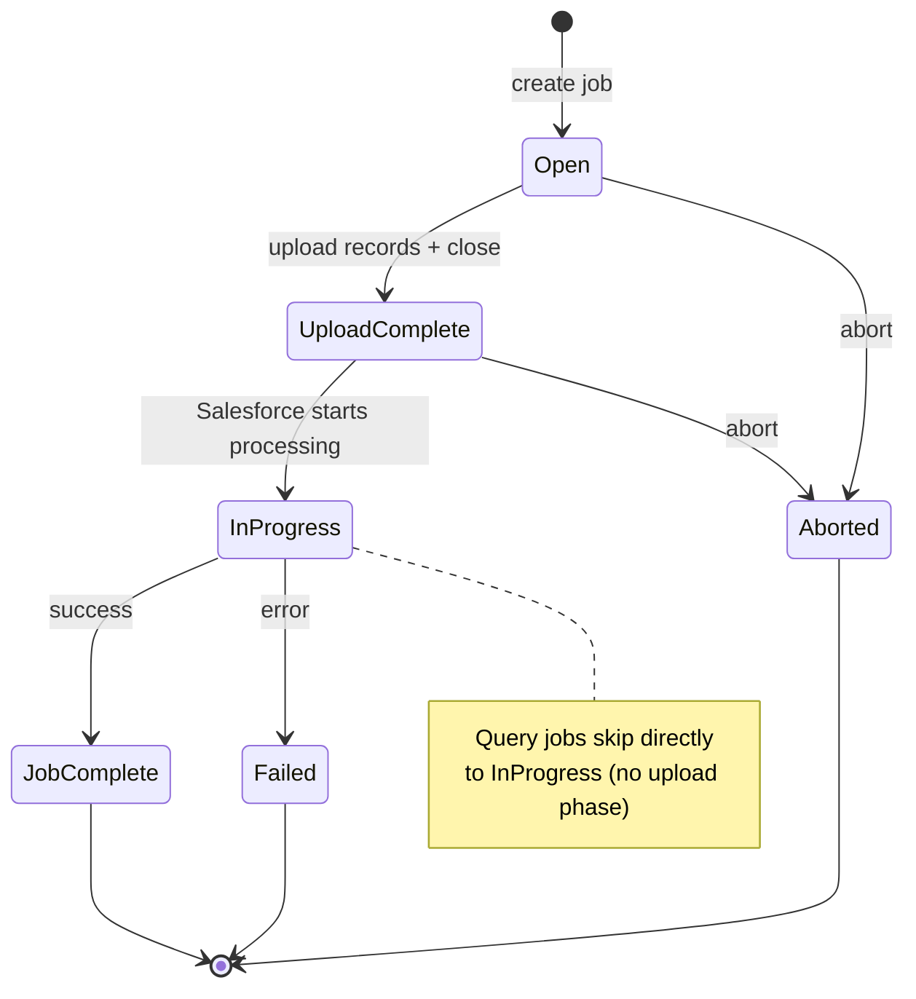

# SF-0005 — Salesforce Bulk API 2.0 Service Design

**Status:** Accepted
**Date:** 2026-05-04
**Scope:** `plynth.connectors.salesforce`

______________________________________________________________________

## Context

The Salesforce Bulk API 2.0 is designed for large-scale data operations: loading
or extracting millions of records asynchronously. It differs fundamentally from
the synchronous REST API:

- Operations are modelled as **jobs** with a lifecycle: create → upload →
  close → poll → retrieve results.
- Data is exchanged as **CSV**, not JSON.
- Jobs are long-running; callers must poll for completion.
- The API distinguishes two job types: **ingest** (insert/update/upsert/delete)
  and **query** (SOQL-based extraction).

The existing `SalesforceObjectService` and `SalesforceQueryService` are
synchronous and JSON-based, making them unsuitable for bulk workloads.

______________________________________________________________________

## Decision

### 1. Dedicated service: `SalesforceBulkService`

Introduce a single `SalesforceBulkService` (and `AsyncSalesforceBulkService`)
that encapsulates the full Bulk API 2.0 job lifecycle.

The service is registered on the facade:

```python
facade.bulk()        # → SalesforceBulkService
async_facade.bulk()  # → AsyncSalesforceBulkService
```

The service is not a subclass of `SalesforceObjectService` or
`SalesforceQueryService` — the Bulk API is a separate endpoint surface with
its own request/response models.

### 2. Job lifecycle methods

The service exposes one high-level helper per job type that manages the full
lifecycle internally, plus low-level primitives for callers who need control.

#### Ingest jobs (insert / update / upsert / delete)

High-level:

```python
result: BulkIngestResult = bulk.ingest(
    sobject="Account",
    operation=BulkOperation.insert,
    records=[{"Name": "Acme"}, ...],      # list[dict] or CSV str
)
```

Low-level primitives:

```python
job: BulkJobInfo = bulk.create_ingest_job(sobject, operation, ...)
bulk.upload_records(job.id, records)
bulk.close_job(job.id)
job = bulk.wait_for_job(job.id)           # polls until terminal state
result = bulk.get_ingest_results(job.id)  # successful + failed + unprocessed
bulk.abort_job(job.id)
bulk.delete_job(job.id)
```

#### Query jobs (SOQL extraction)

High-level:

```python
records: list[dict] = bulk.query("SELECT Id, Name FROM Account")
```

Low-level primitives:

```python
job: BulkJobInfo = bulk.create_query_job(soql, ...)
job = bulk.wait_for_job(job.id)
records = bulk.get_query_results(job.id)  # auto-paginates locator
bulk.abort_job(job.id)
bulk.delete_job(job.id)
```

### 3. Typed models

Introduce typed models in `plynth.connectors.salesforce.bulk`:

| Model              | Description                                                                      |
| ------------------ | -------------------------------------------------------------------------------- |
| `BulkOperation`    | Enum: `insert`, `update`, `upsert`, `delete`, `hard_delete`                      |
| `BulkJobState`     | Enum: `Open`, `UploadComplete`, `InProgress`, `JobComplete`, `Aborted`, `Failed` |
| `BulkJobInfo`      | Full job metadata returned by create/status endpoints                            |
| `BulkIngestResult` | Aggregated result: `successful`, `failed`, `unprocessed` record lists            |
| `BulkQueryResult`  | Aggregated result: `records` list (dicts), `total_count`                         |
| `BulkJobOptions`   | Optional job config: `column_delimiter`, `line_ending`, `external_id_field_name` |

All models are plain dataclasses or `@dataclass`-style typed structures — no
framework dependencies.

### 4. CSV serialisation

CSV serialisation and deserialisation are handled by **private module-level
helpers** inside `bulk/service.py`, not in the transport or renderer.

- `_records_to_csv(records, delimiter, line_ending)` — `list[dict]` → CSV
  string via `csv.DictWriter`; collects all keys across all dicts for the
  header row.
- `_csv_to_records(csv_text)` — CSV string → `list[dict]` via
  `csv.DictReader`; strips **null bytes** before parsing (Salesforce CSV
  responses can contain embedded `\x00` bytes in edge cases).
- The `SalesforceRenderer` is not used for Bulk API calls; the
  `Content-Type` for upload is `text/csv`.
- CSV helpers are **not extracted to a shared utility module**. The logic is
  3–5 lines of stdlib code; the quirks (null bytes, `sf__` prefix awareness)
  are Salesforce-bulk-specific. If a second connector needs CSV handling, we
  extract at that point (YAGNI).

### 4a. Upload URL from create response

The upload endpoint URL (`content_url`) is returned by the job creation
response. The service uses this URL directly for the `PUT` upload request
rather than constructing it from the job ID. This matches the Salesforce
API contract and avoids URL construction bugs.

### 5. Polling strategy

`wait_for_job()` polls the job status endpoint using **exponential backoff**
until the job reaches a terminal state (`JobComplete`, `Aborted`, `Failed`).

- Initial wait: **0.5 s**
- Backoff: exponential growth, capped at **2 s** maximum interval
- Formula: `min(2.0, 0.5 * 2 ** attempt)` — reaches cap after ~2 doublings
- Timeout: `max_wait` (seconds, default `None` = wait indefinitely)
- When `max_wait` is exceeded, `BulkJobTimeoutError` is raised

Exponential backoff is better than fixed polling for bulk jobs: they may
complete in seconds or take minutes. Starting fast and backing off avoids
hammering the status endpoint while not adding unnecessary latency for
short jobs.

The existing `RetryMiddleware` is not involved in polling — polling is an
application-level concern, not a transport retry.

### 6. Error handling

Bulk API errors are mapped into the existing `SalesforceAPIError` hierarchy
where possible:

- HTTP-level errors (4xx/5xx) are handled by the existing
  `raise_for_salesforce_errors()` helper.
- Job-level failures (`state == "Failed"`) raise `SalesforceBulkJobError`
  (a new subclass of `SalesforceAPIError`) with the job ID and error message.
- Timeout during polling raises `BulkJobTimeoutError` (subclass of
  `SalesforceAPIError`).
- Per-record failures in ingest results are surfaced in `BulkIngestResult.failed`
  — they do **not** raise exceptions.

**Abort cleanup on exception**: the high-level `ingest()` and `query()`
helpers wrap the full lifecycle in a try/except. If any exception occurs
after the job is created, `abort_job()` is called before re-raising. This
prevents orphaned open jobs on the Salesforce org. Low-level primitive
callers are responsible for their own cleanup.

### 7. Async-first design

Because bulk jobs are long-running and I/O-bound, the async variant is the
primary implementation. The sync variant wraps the same logic.

Both `SalesforceBulkService` and `AsyncSalesforceBulkService` expose
structurally identical APIs.

### 8. No streaming upload dependency

The initial implementation does **not** require the streaming response feature
(roadmap item 3). CSV data is buffered in memory before upload. Streaming
upload support can be added later if memory constraints arise with very large
datasets.

The Salesforce Bulk API 2.0 enforces a **100 MB per upload request** limit.
For most use cases this fits comfortably in memory.

### 9. Salesforce API constraints and quirks

The following constraints are enforced server-side or are specific to the
Bulk API 2.0 protocol. The implementation must handle or document each one.

#### Job limits

| Constraint                         | Value                           | Note                                                       |
| ---------------------------------- | ------------------------------- | ---------------------------------------------------------- |
| Max upload size per job            | **100 MB** (uncompressed UTF-8) | Enforced by Salesforce; raise clear error on violation     |
| Max concurrent active jobs per org | **15**                          | Salesforce org-wide limit; `SalesforceBulkJobError` on 400 |
| Default query page size            | **50 000 records**              | Configurable via `max_records` on `get_query_results`      |

#### State machine

Ingest jobs follow a strict state machine:



Query jobs skip directly to `InProgress` — there is no upload phase.
`abort_job()` on an already-`JobComplete` or `Failed` job returns an error.

#### Upload endpoint

Salesforce returns a `contentUrl` field in the create-job response body.
**Always use this URL for the PUT upload**, not a manually constructed path.
The URL is relative to the instance URL.

#### Upload response code

A successful CSV upload returns **HTTP 201 Created**, not 200. Any other
status code is an error.

#### CSV Content-Type

Upload requests must use `Content-Type: text/csv; charset=UTF-8`.
Result retrieval requests must send `Accept: text/csv; charset=UTF-8`.

#### Query result pagination

- The `Sforce-Locator` response header carries the page cursor.
- When Salesforce has no further pages, it returns the **string `"null"`**
  (not an absent header). Treat `"null"` as end-of-pages.
- `Sforce-NumberOfRecords` carries the record count for the current page.

#### `queryAll` vs `query`

- `query` returns only non-archived, non-deleted records.
- `queryAll` includes soft-deleted and archived records.
- Both use the `/jobs/query` endpoint; the distinction is in the `operation`
  field of the job creation payload.

#### Null bytes in CSV responses

Salesforce CSV responses can contain embedded null bytes (`\x00`) in edge
cases (known issue, see [airbytehq/airbyte#8300]). Strip them before parsing.

#### `hard_delete` permission

The `hard_delete` operation requires the org-level `BulkApiHardDelete`
permission. This is not checked client-side; a `403 Forbidden` from
Salesforce will surface as a `SalesforcePermissionError`.

#### `external_id_field_name` for upsert

For `upsert` operations, `external_id_field_name` is required in the job
creation payload. The service must validate this at the Python level and raise
`ValueError` before sending the request.

______________________________________________________________________

## Consequences

- `SalesforceBulkService` lives in `plynth.connectors.salesforce.bulk`.
- Two new exception types are added to `plynth.connectors.salesforce.errors`:
  `SalesforceBulkJobError` and `BulkJobTimeoutError`.
- The facade gains a `bulk()` / `async_bulk()` accessor.
- No changes to the transport, base request/response layer, or any existing
  services.
- The service validates `external_id_field_name` presence for `upsert` at
  call time (raises `ValueError`), not relying on Salesforce to return a 400.
- Upload payloads exceeding 100 MB raise `ValueError` before sending.
- Roadmap item 2e is complete when `SalesforceBulkService`,
  `AsyncSalesforceBulkService`, and full test coverage are in place.

______________________________________________________________________

## Rejected alternatives

### A. Extend `SalesforceObjectService` with bulk methods

Rejected. The Bulk API lifecycle (job create → upload → poll → retrieve) does
not fit the synchronous, per-record request/response pattern of
`SalesforceObjectService`. Mixing them would bloat the service and obscure the
API contract.

### B. Streaming upload via `httpx` streaming

Deferred. Not required for the 150 MB limit; adds implementation complexity
and couples this work to roadmap item 3. Revisit if large-file upload becomes
a real use case.

### C. Auto-chunk large datasets

Deferred to a future iteration. The service accepts records as-is and raises
a clear error if the payload exceeds the 150 MB limit. Chunking adds
significant complexity with limited immediate demand.
