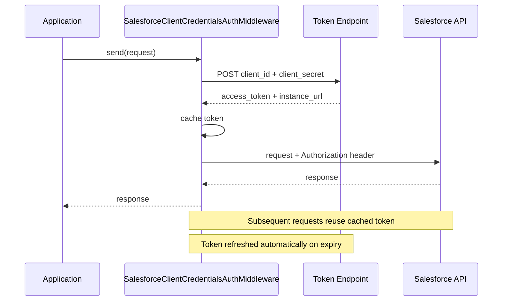
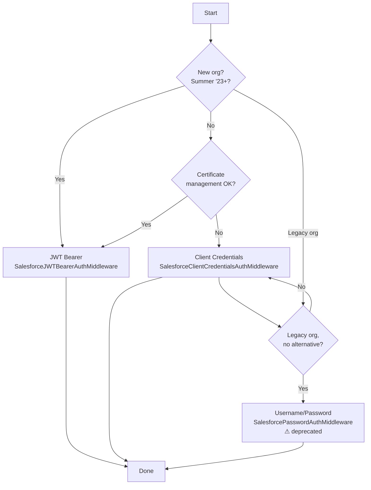

# Authentication flows explained

This article explains the OAuth 2.0 flows that Salesforce supports, when
to use each one, and the limitations that affect which flow Plynth can use.

## Client Credentials (recommended for Spring '23+ orgs)

**OAuth 2.0 Client Credentials Grant** is the correct choice for
server-to-server integrations where no human user is involved.

### How Client Credentials works



1. The application sends its `client_id` and `client_secret` to the token
   endpoint.
1. Salesforce validates the credentials and returns an access token and the
   org's `instance_url`.
1. All subsequent API calls include the access token in the `Authorization`
   header.
1. The middleware refreshes the token automatically when it expires.

### Why it is preferred

- No username or password stored in application configuration.
- The access token is tied to the Connected App, not a named user license.
- Fully supported as a standard in Salesforce Spring '23 and later.

### Connected App setup (Client Credentials)

In Salesforce Setup → App Manager, the Connected App must have:

- **OAuth scopes**: *Manage user data via APIs (api)* plus any other scopes
  your integration needs.
- **Enable Client Credentials Flow**: checked.
- **Run As**: a dedicated integration user with minimum required permissions.

### Token URL

| Environment                             | Token URL                                               |
| --------------------------------------- | ------------------------------------------------------- |
| Production / Developer Edition          | `https://login.salesforce.com/services/oauth2/token`    |
| Sandbox                                 | `https://test.salesforce.com/services/oauth2/token`     |
| Custom domain (after `My Domain` setup) | `https://myorg.my.salesforce.com/services/oauth2/token` |

## Username/Password (Resource Owner Password Credentials)

**ROPC** flow sends the user's credentials directly to the token endpoint.
Salesforce has deprecated this flow and it is blocked by default in orgs
created with Summer '23 or later.

### When it may still be needed

- Legacy orgs where Client Credentials is not available.
- Automation users in orgs where the Connected App cannot be configured with
  a *Run As* policy.

### Limitations

- Requires a named Salesforce user license.
- Blocked by MFA enforcement unless the user has an MFA exclusion profile.
- The password expires when the Salesforce user's password expires.
- A security token must be appended to the password unless the automation
  server's IP address is on the org's allowlist.

### Deprecation timeline

Salesforce announced the deprecation of ROPC in 2022 (Summer '22 release
notes). New orgs created Summer '23 and later cannot enable it. Existing
orgs retain access but Salesforce may remove it in a future major release.

## JWT Bearer Token (recommended for new orgs)

The **OAuth 2.0 JWT Bearer Token** flow signs a JSON Web Token with a
private key and exchanges it for an access token — no shared secret is
transmitted. This is the Salesforce-recommended flow for server-to-server
integrations and is mandatory for orgs created Summer '23 or later.

### How JWT Bearer Token works

1. The application generates a short-lived JWT, signed with a private RSA key.
1. The JWT (`iss`, `sub`, `aud`, `exp` claims) is sent to the token endpoint.
1. Salesforce verifies the signature against a certificate registered in the
   Connected App.
1. Salesforce returns an access token and `instance_url`.
1. All subsequent API calls use that token. The middleware refreshes it
   automatically before expiry.

### Why it is preferred over Client Credentials

- No shared secret is ever transmitted over the network.
- Compromise of the certificate does not expose a reusable password.
- Mandatory for Summer '23+ orgs where ROPC is blocked by default.
- The JWT assertion is signed locally; Plynth never stores the private key
  beyond the middleware instance's lifetime.

### Connected App setup (JWT Bearer)

In Salesforce Setup → App Manager the Connected App must have:

- **Use Digital Signatures**: checked, with the public certificate (`.crt`)
  uploaded.
- **Permitted Users**: *Admin approved users are pre-authorized*.
- The integration user assigned via a **Permission Set** on the Connected App.

### Built-in middleware

```python
import os
from plynth.connectors.salesforce.auth import SalesforceJWTBearerAuthMiddleware
from plynth.connectors.salesforce.client import SalesforceAPIClient
from plynth.http.transport import HttpxSyncTransport

auth = SalesforceJWTBearerAuthMiddleware(
    client_id=os.environ["SF_CLIENT_ID"],
    username=os.environ["SF_USERNAME"],
    private_key=os.environ["SF_PRIVATE_KEY_PEM"],  # PEM string; never hardcode
    token_url="https://login.salesforce.com/services/oauth2/token",
)
transport = HttpxSyncTransport(middlewares=[auth])
client = SalesforceAPIClient(auth=auth, transport=transport)
```

Sandbox: change `token_url` to `https://test.salesforce.com/services/oauth2/token`;
the JWT `aud` claim is derived automatically.

**Dependencies:** requires `PyJWT>=2.8` and `cryptography>=42`, both included
in `pip install 'plynth[salesforce]'`.

## Choosing a flow



## Summary table

| Flow                     | Requires named user | Supported in new orgs       | Built-in middleware                         |
| ------------------------ | ------------------- | --------------------------- | ------------------------------------------- |
| JWT Bearer               | No                  | Yes — mandatory Summer '23+ | `SalesforceJWTBearerAuthMiddleware`         |
| Client Credentials       | No                  | Yes (Spring '23+)           | `SalesforceClientCredentialsAuthMiddleware` |
| Username/Password (ROPC) | Yes                 | No (deprecated Summer '23+) | `SalesforcePasswordAuthMiddleware`          |
| Session token            | N/A                 | Yes (edge case)             | `SalesforceSessionAuthMiddleware`           |
