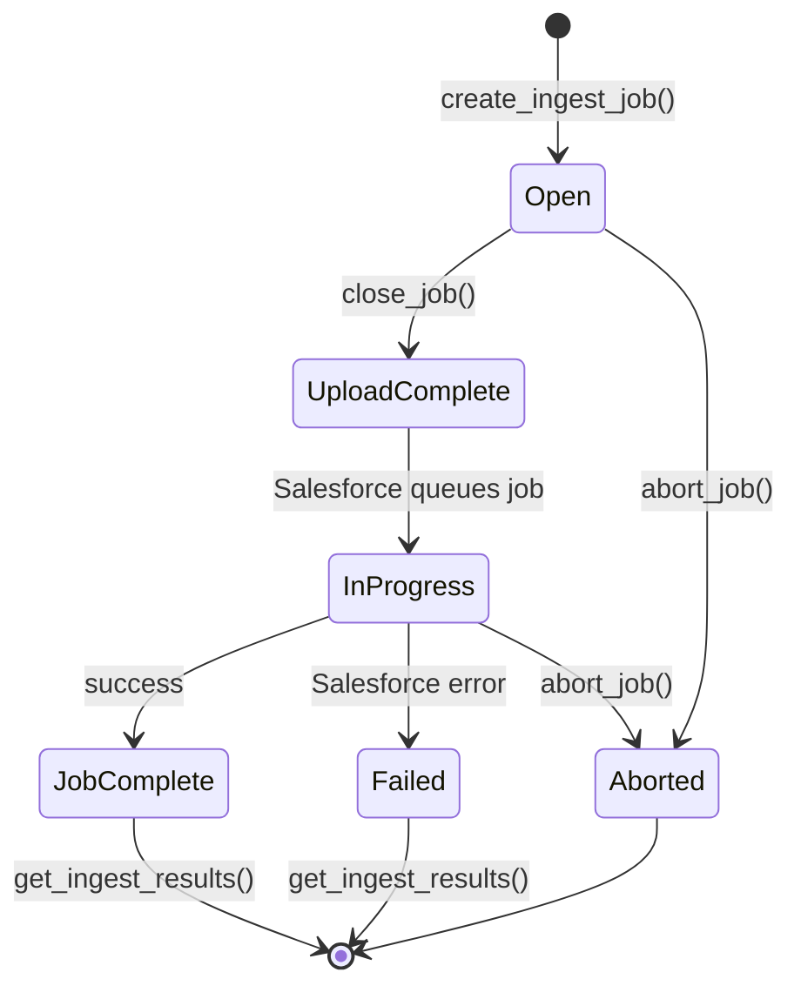

# Run Bulk API operations

Use `SalesforceBulkService` for high-volume data operations — typically
10 000 records or more — where the REST API per-record overhead would
consume too much quota.

## Prerequisites

A configured `SalesforceAPIFacade`:

```python
from plynt.connectors.salesforce.facade import SalesforceAPIFacade

sf = SalesforceAPIFacade(client)
bulk = sf.bulk()
```

______________________________________________________________________

## High-level ingest (insert / update / upsert / delete)

`ingest()` handles the full job lifecycle — create, upload, close, wait,
and retrieve results — in a single call:

```python
from plynt.connectors.salesforce.bulk.service import BulkOperation

records = [
    {"FirstName": "Alice", "LastName": "Smith", "Email": "alice@example.com"},
    {"FirstName": "Bob", "LastName": "Jones", "Email": "bob@example.com"},
]

result = bulk.ingest(
    sobject="Contact",
    operation=BulkOperation.insert,
    records=records,
)

print(f"Successful: {len(result.successful)}")
print(f"Failed:     {len(result.failed)}")
print(f"Unprocessed:{len(result.unprocessed)}")
```

`BulkIngestResult` fields:

| Field         | Type         | Description                                     |
| ------------- | ------------ | ----------------------------------------------- |
| `successful`  | `list[dict]` | Records that were processed without error       |
| `failed`      | `list[dict]` | Records Salesforce rejected with error details  |
| `unprocessed` | `list[dict]` | Records not yet processed when the job finished |

______________________________________________________________________

## Update existing records

```python
updates = [
    {"Id": "003Dn000001aaa", "Phone": "+31 20 000 0001"},
    {"Id": "003Dn000001bbb", "Phone": "+31 20 000 0002"},
]
result = bulk.ingest("Contact", BulkOperation.update, updates)
```

______________________________________________________________________

## Upsert by external ID

```python
from plynt.connectors.salesforce.bulk.service import BulkOperation

result = bulk.ingest(
    sobject="Contact",
    operation=BulkOperation.upsert,
    records=[{"Employee_Number__c": "EMP-101", "LastName": "Brown"}],
    external_id_field="Employee_Number__c",
)
```

______________________________________________________________________

## Delete records

```python
result = bulk.ingest(
    sobject="Contact",
    operation=BulkOperation.delete,
    records=[{"Id": "003Dn000001aaa"}, {"Id": "003Dn000001bbb"}],
)
```

______________________________________________________________________

## High-level bulk query

`query()` creates a query job, waits for completion, and returns all
records as a list:

```python
records = bulk.query(
    "SELECT Id, Name, Email FROM Contact WHERE IsDeleted = false LIMIT 50000"
)
for record in records:
    print(record["Id"], record["Email"])
```

To include soft-deleted records:

```python
records = bulk.query(soql, include_deleted=True)
```

______________________________________________________________________

## Control timeout

Both `ingest()` and `query()` poll until the job reaches a terminal state.
Set `max_wait` (in seconds) to raise `TimeoutError` instead of polling
indefinitely:

```python
result = bulk.ingest("Lead", BulkOperation.insert, records, max_wait=120.0)
```

______________________________________________________________________

## Handle failed records

Inspect individual row-level failures from Salesforce:

```python
for row in result.failed:
    sf_id = row.get("sf__Id", "new")
    error = row.get("sf__Error", "unknown")
    print(f"Row {sf_id} failed: {error}")
```

______________________________________________________________________

## Low-level job lifecycle

The Bulk API 2.0 job moves through these states:



Use the primitive methods when you need fine-grained control — for example
to upload records in multiple batches or monitor an existing job:

```python
job = bulk.create_ingest_job("Contact", BulkOperation.insert)
bulk.upload_records(job.id, records[:5000], content_url=job.content_url)
bulk.upload_records(job.id, records[5000:])
bulk.close_job(job.id)
finished = bulk.wait_for_job(job.id, is_query=False, max_wait=300.0)
result = bulk.get_ingest_results(finished.id)
```

______________________________________________________________________

## Async

```python
from plynt.connectors.salesforce.facade import AsyncSalesforceAPIFacade

sf = AsyncSalesforceAPIFacade(async_client)
bulk = sf.bulk()

result = await bulk.ingest("Contact", BulkOperation.insert, records)
rows = await bulk.query("SELECT Id FROM Contact LIMIT 100000")
```

______________________________________________________________________

## See also

- [Create, update, and delete SObject records](sobject-crud.md) — for
  single-record REST operations
- [Query records with SOQL](query-records.md)
- [Services reference](../reference/services.md)
