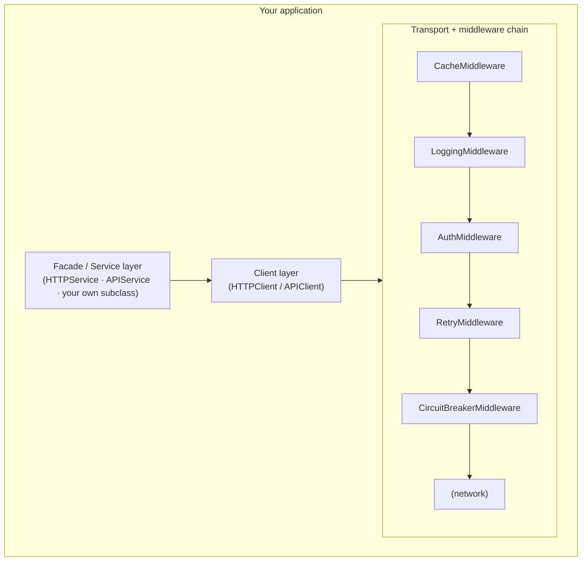

# Plynth user documentation

Plynth is a framework-agnostic Python HTTP client library. It provides a
layered architecture — transport, middleware, client, and service — that
makes it easy to integrate with external APIs and to add cross-cutting
concerns (caching, retries, circuit breaking, authentication, logging) in a
composable way.

## Architecture overview



See [Architecture explanation](explanation/architecture.md) for a full
description of each layer.

## Documentation structure

Documentation follows the [Diátaxis](https://diataxis.fr/) framework:

| Section                              | Purpose                      | Start here when...                                       |
| ------------------------------------ | ---------------------------- | -------------------------------------------------------- |
| [Tutorials](tutorials/README.md)     | Step-by-step learning guides | You are new to Plynth                                    |
| [How-to guides](how-to/README.md)    | Task-oriented recipes        | You need to accomplish a specific goal                   |
| [Reference](reference/README.md)     | Technical API descriptions   | You need to look up a class, setting, or error           |
| [Explanation](explanation/README.md) | Conceptual background        | You want to understand *why* things work the way they do |

## Quick start

```bash
pip install "plynth[httpx]"
```

```python
from plynth.http.transport import HttpxSyncTransport
from plynth.http.client import APIClient

transport = HttpxSyncTransport()
client = APIClient(base_url="https://api.example.com", transport=transport)
response = client.get("/items")
print(response.json())
```

See [Tutorial 1 — Getting started](tutorials/01-getting-started.md) for a
full walkthrough.

## Connectors

Plynth ships with a Salesforce connector. Connector-specific documentation
lives alongside the connector:

- [Generic LLM connector](../connectors/llm/README.md)
- [Salesforce connector](../connectors/salesforce/user/README.md)

## Runnable examples

Use runnable examples when you want to validate credentials, endpoint setup,
and basic service behavior end-to-end.

- [LLM examples](../../examples/llm/README.md)
- [Django examples](../../examples/django/README.md)
- [Salesforce examples](../../examples/salesforce/README.md)

## Installation extras

| Extra                | Installs                          | Use when                             |
| -------------------- | --------------------------------- | ------------------------------------ |
| `plynth[httpx]`      | `httpx2`                          | You need the built-in HTTP transport |
| `plynth[salesforce]` | `httpx2`, `PyJWT`, `cryptography` | Salesforce connector                 |
| `plynth[oauth]`      | OAuth2 helpers                    | Custom OAuth2 flows                  |
| `plynth[dev]`        | Test and lint dependencies        | Contributing to Plynth               |

See [Installation reference](reference/installation.md) for details.
