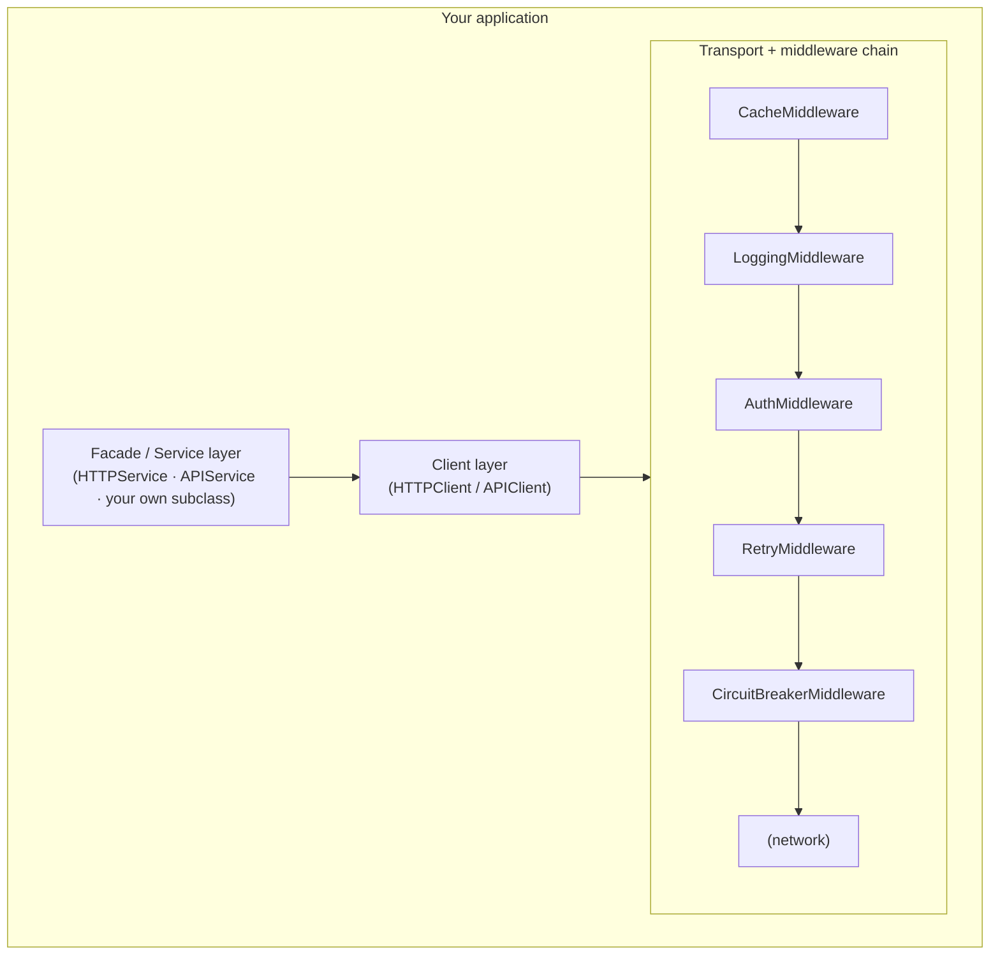

# Plynt user documentation

Plynt is a framework-agnostic Python HTTP client library. It provides a layered
architecture — transport, middleware, client, and service — that makes it easy
to integrate with external APIs and to add cross-cutting concerns (caching,
retries, circuit breaking, authentication, logging) in a composable way.

## Architecture overview



See [Architecture explanation](explanation/architecture.md) for a full
description of each layer.

## Documentation structure

Documentation follows the [Diátaxis](https://diataxis.fr/) framework:

| Section                              | Purpose                      | Start here when...                                       |
| ------------------------------------ | ---------------------------- | -------------------------------------------------------- |
| [Tutorials](tutorials/README.md)     | Step-by-step learning guides | You are new to Plynt                                     |
| [How-to guides](how-to/README.md)    | Task-oriented recipes        | You need to accomplish a specific goal                   |
| [Reference](reference/README.md)     | Technical API descriptions   | You need to look up a class, setting, or error           |
| [Explanation](explanation/README.md) | Conceptual background        | You want to understand *why* things work the way they do |

## Upgrade guidance

Review the [typed transport and authentication error migration guide](migrations/typed-transport-errors.md)
before upgrading across a 0.x release containing those breaking changes.

## Quick start

```bash
pip install "plynt[httpx]"
```

```python
from plynt.http.transport import HttpxSyncTransport
from plynt.http.client import APIClient

transport = HttpxSyncTransport()
client = APIClient(base_url="https://api.example.com", transport=transport)
response = client.get("/items")
print(response.json())
```

See [Tutorial 1 — Getting started](tutorials/01-getting-started.md) for a full
walkthrough.

## Optional extensions

This section documents shared library functionality. Extension-specific
configuration and usage are documented separately:

- [Framework adapters](../adapters/README.md)
- [Connectors](../connectors/)

## Installation extras

Install `plynt[httpx]` for built-in HTTP transports. OAuth2 helpers are included
in the package; there is no separate `oauth` extra. Choose adapter and connector
extras from their respective guides.

See the canonical [installation reference](reference/installation.md) for the
complete profiles, runtime compatibility, and development commands.
