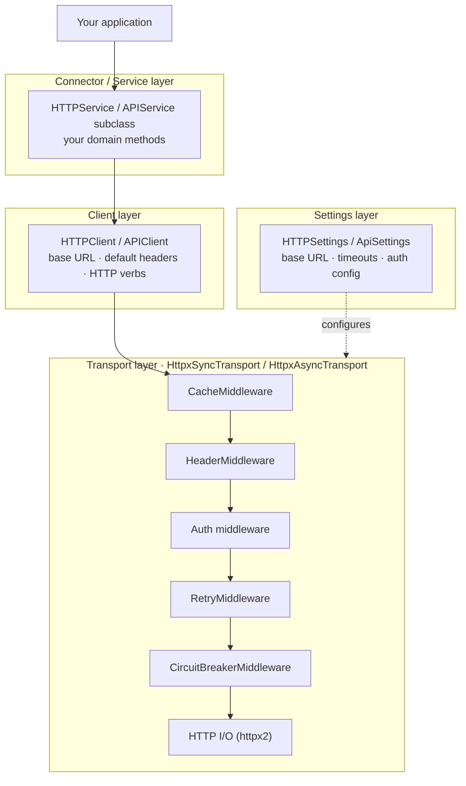
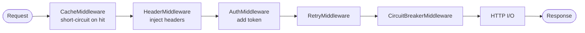

# Plynth architecture

This article describes how Plynth is structured and how its layers
interact. Reading it will help you understand where to hook in your own
logic and why each piece exists where it does.

## HTTP layers at a glance



## The transport layer

The HTTP **transport** is the component that makes HTTP network calls. It wraps
an HTTP library (currently httpx2) and applies the middleware chain before
and after every request.

`HttpxSyncTransport` and `HttpxAsyncTransport` are the concrete
implementations. Both extend abstract base classes
(`BaseSyncTransport` / `BaseAsyncTransport`) so that connectors and tests
can substitute alternative transports.

```python
from plynth.http.transport import HttpxSyncTransport

transport = HttpxSyncTransport()
```

## The middleware chain

Middleware runs inside the transport. Each middleware wraps the next in an
**onion model**: the outermost middleware runs first on the way in and
last on the way out.



### Middleware ordering convention

The first element in the `middlewares` list is **outermost** — it sees
every request first and every response last. This matches Django, ASGI,
and Express conventions.

```python
transport = HttpxSyncTransport(
    middlewares=[
        CacheMiddleware(backend),           # outermost — short-circuit first
        HeaderMiddleware({"User-Agent": "my-app/1.0"}),
        OAuth2ClientCredentialsAuthMiddleware(...),
        RetryMiddleware(RetryPolicy(max_attempts=3)),
        CircuitBreakerMiddleware(policy),   # innermost above I/O
    ]
)
```

See [Middleware ordering and the onion model](middleware-model.md) for a
detailed explanation of why ordering matters.

## The client layer

`HTTPClient` sits above the transport. It adds:

- **Base URL composition** — relative paths are appended to the base URL.
- **Default headers** — merged with per-request headers.
- **HTTP verb shortcuts** — `.get()`, `.post()`, `.put()`, `.patch()`,
  `.delete()`.

`APIClient` extends `HTTPClient` with JSON REST conventions:

- Sends `Content-Type: application/json` and `Accept: application/json`
  on every request.
- Raises a typed `HttpStatusError` for 4xx and 5xx by default.
- Supports `raw=True` on `request()` when you need direct access to
  upstream status and headers without typed exception mapping.

```python
from plynth.http.client import APIClient

client = APIClient(base_url="https://api.example.com", transport=transport)
resp = client.get("/items")          # raises on 4xx/5xx automatically
```

### Raw mode and layer boundary

`HTTPClient` is already the raw layer. It always returns a `Response`
without status-to-exception mapping.

`APIClient` adds the mapping behavior and therefore owns the `raw` toggle:

```python
resp = client.get("/items/42", raw=True)
if resp.status_code == 404:
    ...
```

Internally, verb helpers (`get`, `post`, and others) forward extra keyword
arguments to `request()`. This keeps the API DRY and avoids duplicated
override methods in subclasses. Trade-off: verb signatures are less explicit
about subclass-specific options such as `raw`.

## The service layer

Services wrap a client and translate raw `Response` objects into domain
models. Your application code interacts with services — never with clients
or transports directly.

```python
from plynth.http.service import APIService

class ItemService(APIService):
    def list_items(self) -> list[Item]:
        resp = self._client.get("/items")
        return [Item.model_validate(r) for r in resp.json()]

    def get_item(self, item_id: str) -> Item:
        resp = self._client.get(f"/items/{item_id}")
        return Item.model_validate_json(resp.content)
```

`APIService` provides `self._client` (an `APIClient`). `HTTPService`
provides the same for non-JSON services.

## The settings layer

`HTTPSettings` centralises all transport configuration: base URL,
timeouts, auth config, and cache config. Services are typically wired up
from a single settings object.

```python
from plynth.http.settings import HTTPSettings
from plynth.http.auth import OAuth2ClientCredentialsConfig

class MyServiceSettings(HTTPSettings):
    model_config = SettingsConfigDict(env_prefix="MY_", env_file=".env")
    client_id: str = ""
    client_secret: str = ""

    @property
    def auth(self):
        return OAuth2ClientCredentialsConfig(
            client_id=self.client_id,
            client_secret=self.client_secret,
            token_url="https://auth.example.com/token",
        )

settings = MyServiceSettings()
transport = HttpxSyncTransport.from_settings(settings)
```

`from_settings()` reads `base_url`, timeouts, auth, and cache config from
the settings object and constructs a fully wired transport.

## The cache layer

`CacheBackend` is a simple protocol: `get`, `set`, `delete`, `clear`.
Plynth ships four implementations:

| Backend           | When to use                                 |
| ----------------- | ------------------------------------------- |
| `LocMemCache`     | Development or single-process apps          |
| `RedisCache`      | Multi-process or multi-instance deployments |
| `CachetoolsCache` | LRU / TTL eviction in-process               |
| `DummyCache`      | Testing — cache is always a miss            |

See [Cache backends reference](../reference/cache-backends.md).

## How connectors use these layers

Built-in connectors (for example, the Salesforce connector) follow the
same pattern you would use for your own connector:

1. **Settings** subclass of `ApiSettings` with connector-specific fields.
1. **Auth middleware** subclass of `SyncMiddleware` (or `AsyncMiddleware`).
1. **Service classes** extending `APIService`.
1. **A facade** (optional) that constructs services on demand from a single
   client instance.

See [Tutorial: Build your own connector](../tutorials/02-build-a-connector.md)
to create a connector from scratch.

## Optional gRPC and Salesforce CDC

The HTTP diagrams above do not describe gRPC. `plynth.grpc` is a sibling
protocol namespace with async transport/client helpers and protocol-specific
interceptors. It does not reuse the HTTP middleware chain.

The experimental Salesforce CDC package wraps a caller-supplied async gRPC
channel through its Pub/Sub adapter. Auth metadata, schema caching, Avro
decoding, field bitmap expansion, flow control, replay, and checkpoints stay
inside the connector. Snapshot reconciliation and durable processing belong
to the consuming application.

Install `plynth[grpc,salesforce]` and see the
[CDC deployment guide](../../connectors/salesforce/user/how-to/deploy-cdc.md).
This path is async-only and still requires real-org validation.
See [ADR-0030](../../architecture/adr/0030-grpc-protocol-boundary.md) and
[ADR-0031](../../architecture/adr/0031-experimental-release-installation-contract.md)
for protocol and installation boundaries.

Core-only installations can still import HTTP clients and inject their own
transports. Constructing a built-in httpx2 transport requires `plynth[http]`;
see the [installation reference](../reference/installation.md).
