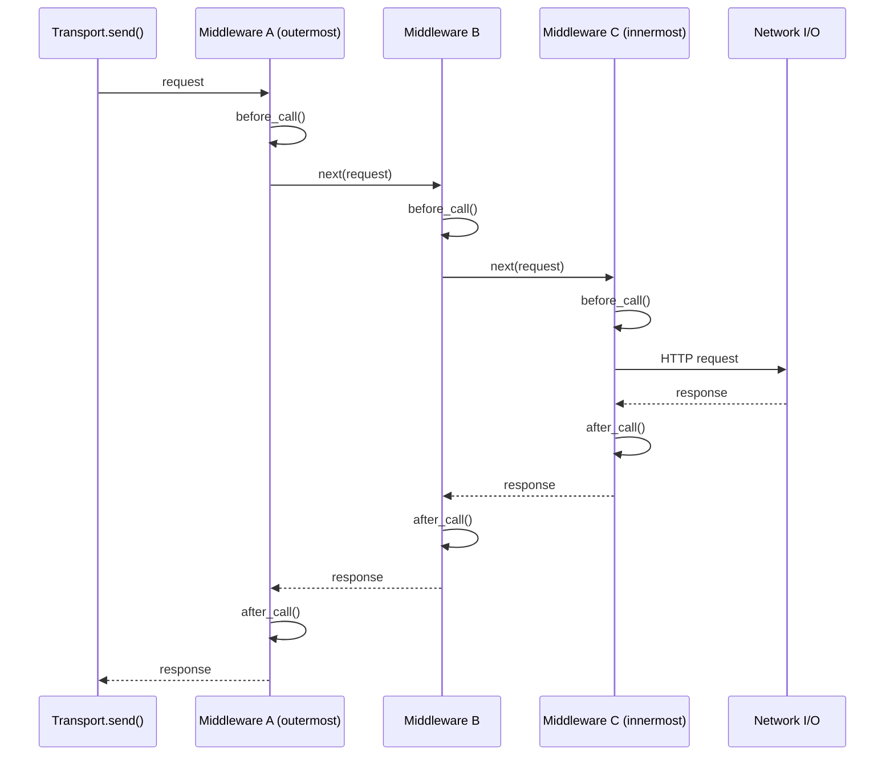
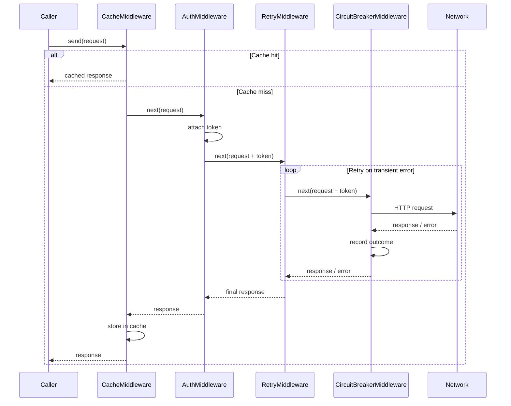

# Middleware — ordering and the onion model

## What middleware is

Middleware in Plynth is **transport-level** logic. Each middleware wraps
the next in a chain of responsibility. When a request enters the chain it
flows inward through every middleware, hits the network, then flows back
outward through every middleware in reverse.

This is the onion (or pipeline) model used by Django, ASGI, Express, and
most modern web frameworks.

## The onion model in detail



## Why ordering matters

Because each middleware sees the request *before* passing it inward and
the response *after* returning from inward, position in the list controls
scope and precedence.

### Cache (outermost)

The cache should be outermost so it can short-circuit the entire chain on
a hit — no auth token is fetched, no network call is made, no retry
counter is incremented.

### Auth (middle)

Auth sits inside any caching or header middleware but outside retry.
This means every retry attempt carries a valid, up-to-date token. If auth
were outside retry, the token would be fetched once before retries began;
if the token expired mid-retry-loop the subsequent attempts would fail with
401\.

### Retry (inside auth, outside circuit breaker)

Retry sits between auth and the circuit breaker. On a transient 503, the
circuit breaker (innermost) counts the failure and passes the error up;
retry then fires a new attempt back down through the circuit breaker.
With this arrangement, the breaker counts each individual attempt — so
persistent failures trip the circuit quickly. If you want the breaker to
count only exhausted-retry failures, place `CircuitBreakerMiddleware`
outside `RetryMiddleware` instead.

### Circuit breaker (innermost above I/O)

The circuit breaker is innermost so it counts only requests that actually
reach the network after passing through all other middleware.

### Recommended order



```python
transport = HttpxSyncTransport(
    middlewares=[
        CacheMiddleware(backend),               # outermost
        HeaderMiddleware({"User-Agent": "..."}),
        OAuth2ClientCredentialsAuthMiddleware(...),
        RetryMiddleware(RetryPolicy(max_attempts=3)),
        CircuitBreakerMiddleware(policy),        # innermost above I/O
    ]
)
```

## What middleware can and cannot do

Middleware has access to `Request` and `Response` only:

- URL, method, headers, body, status code.
- It can short-circuit (return a response without calling `next_handler`).
- It can mutate the request before calling `next_handler`.
- It can transform the response after receiving it.

Middleware does **not** have access to:

- Service-level context (which operation was called, business domain data).
- Authentication state beyond what is in the headers.
- Application or request-scoped data.

If you need to add logic that requires domain context, put it in the
**service layer** instead.

## Writing custom middleware

Implement the `SyncMiddleware` protocol:

```python
import time
from plynth.base.middleware import SyncMiddleware
from plynth.base.request import Request
from plynth.base.response import Response
from collections.abc import Callable

class TimingMiddleware(SyncMiddleware):
    def handle(
        self,
        request: Request,
        next_handler: Callable[[Request], Response],
    ) -> Response:
        start = time.monotonic()
        response = next_handler(request)
        elapsed = time.monotonic() - start
        print(f"{request.method} {request.url} → {response.status_code} in {elapsed:.3f}s")
        return response
```

See [How to write custom middleware](../how-to/write-middleware.md) for a
complete guide.
