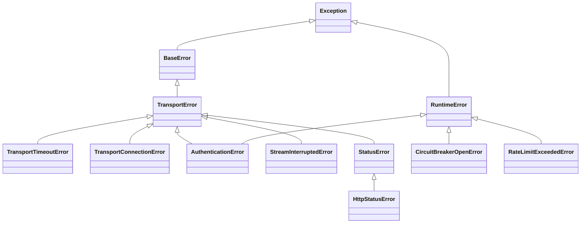

# How to handle errors

Plynt maps HTTP status codes to typed Python exceptions. Catch the most
specific exception you need and let the rest propagate.

## Core exception hierarchy



Arrows point to the parent class. Core errors live in `plynt.base.errors`;
`HttpStatusError` lives in `plynt.http.errors`. Circuit breaker and rate limit
errors live in their respective middleware modules.

The HTTP status subclasses of `HttpStatusError` are:

| Error                      | HTTP status |
| -------------------------- | ----------- |
| `BadRequestError`          | 400         |
| `UnauthorizedError`        | 401         |
| `ForbiddenError`           | 403         |
| `NotFoundError`            | 404         |
| `NotAllowedError`          | 405         |
| `RequestTimeoutError`      | 408         |
| `ConflictError`            | 409         |
| `GoneError`                | 410         |
| `UnprocessableEntityError` | 422         |
| `InternalServerError`      | 500         |
| `OperationFailedError`     | 500         |
| `ServiceUnavailableError`  | 503         |
| `FeatureOfflineError`      | 503         |

## Transport timeout and connection errors

`TransportTimeoutError` and `TransportConnectionError` are protocol-agnostic
subclasses of `TransportError`, exported from `plynt.base`. Neither represents
an HTTP response status: a network timeout is not an HTTP 408 response.

- `TransportTimeoutError` represents connect, read, write, or pool timeouts.
- `TransportConnectionError` represents connection, network, proxy, or remote
  protocol failures.

Both inherit the standard `message`, `code`, and `details` contract. Their
default codes are `TRANSPORT_TIMEOUT` and `TRANSPORT_CONNECTION_ERROR`.
Implementations can preserve the original exception with `raise ... from exc`.

Built-in HTTP transports raise these types for network failures while sending
a request or opening a stream. The original backend exception is preserved in
`__cause__`, not copied into the message. Local protocol errors, unsupported
protocols, and programming errors propagate unchanged.

Failures during iteration of an already returned stream continue to use the
existing `StreamInterruptedError` contract. Streams are never retried after
being returned to the caller.

### Migrate backend exception handlers

Under [ADR-0039](../../architecture/adr/0039-typed-transport-and-authentication-errors.md),
handlers catching `httpx2.TimeoutException` or network exceptions no longer
match failures from built-in transports. Catch the plynt types instead:

```python
from plynt.base import TransportConnectionError, TransportTimeoutError

try:
    response = client.get("/items")
except TransportTimeoutError:
    print("Upstream request timed out")
except TransportConnectionError:
    print("Upstream connection failed")
```

The default `HttpRetryPolicy` recognizes both types and still accepts raw
backend network exceptions from custom transports. Explicit retry classifiers
replace that default: update classifiers that only match httpx2 exceptions.

## Authentication errors

`AuthenticationError` is exported from `plynt.base`. It inherits from both
`TransportError` and `RuntimeError`, preserving compatibility with existing
`except RuntimeError` handlers for token failures.

```python
from plynt.base import AuthenticationError

error = AuthenticationError(status_code=401, response_body=b"Upstream response")
assert error.status_code == 401
assert error.code == "AUTHENTICATION_ERROR"
```

The message contains the status code, not the upstream response body. The body
is available only through `response_body`; it is excluded from `str()`,
`repr()`, exception arguments, and `to_dict()`. Do not log this attribute:
authentication responses may contain sensitive data.

Built-in OAuth2 token flows raise this type when the token
endpoint returns a status other than 200. Client credentials, password, and
JWT bearer flows share this behavior in sync and async code. Token validation
and cache configuration errors retain their existing exception types.

Existing `except RuntimeError` handlers still catch token response failures.
For more specific handling, catch `AuthenticationError` and inspect
`status_code`. Code parsing the old exception message must use this attribute
instead; the response body is no longer included in the message.

## Catch HTTP status errors

`APIClient` raises `HttpStatusError` (or a subclass) for `4xx` and `5xx` responses.

```python
from plynt.http.errors import NotFoundError, HttpStatusError

try:
    response = client.get("/items/42")
except NotFoundError:
    print("Item does not exist")
except HttpStatusError as exc:
    print(f"HTTP error {exc.status_code}: {exc.url}")
```

The `response` attribute on the exception holds the raw response:

```python
except HttpStatusError as exc:
    body = exc.response.json() if exc.response else {}
```

## Bypass typed mapping with raw mode

`APIClient` raises `HttpStatusError` for `4xx` and `5xx` responses by
default. Responses with a `1xx`, `2xx`, or `3xx` status code are returned
directly without any exception mapping — no flag is needed for those.

Use `raw=True` only when you need to receive a `4xx` or `5xx` response
without an exception:

```python
response = client.get("/items/42", raw=True)

if response.status_code == 404:
    print("Item does not exist")
```

Typical use cases:

- Inspect the body of a `4xx` error response that carries a structured
  payload before deciding how to handle it.
- Forward upstream `4xx`/`5xx` responses to another service without
  triggering local error handling.
- Write test helpers that need to assert on error response details.

Note: `HTTPClient` already behaves as a raw client. The `raw` toggle is only
needed when using `APIClient` or `AsyncAPIClient`.

## Construct a typed error from a status code

Use `match_error` to get the most specific subclass for a known status code:

```python
from plynt.http.errors import match_error

err = match_error(404, method="GET", url="/items/1")
# err is a NotFoundError instance
```

## Catch circuit breaker errors

```python
from plynt.middleware.circuit_breaker import CircuitBreakerOpenError

try:
    response = client.get("/items")
except CircuitBreakerOpenError as exc:
    print(f"Circuit open — retry after {exc.retry_after_seconds:.0f}s")
```

## Catch rate limit errors

```python
from plynt.middleware.rate_limit import RateLimitExceededError

try:
    response = client.post("/items", json={"name": "x"})
except RateLimitExceededError:
    print("Client-side rate limit hit — slow down")
```

## Build an external error envelope

`build_error_envelope` provides the shared core contract from ADR-0040.
The caller selects the status code and supplies the active request ID;
the core does not map statuses, generate IDs, or create framework responses.

Without a custom callable, the payload retains the existing `message` and
`code` fields. A `BaseError` exposes its message and code, with
`INTERNAL_SERVER_ERROR` when its code is absent. Other exceptions return the
generic internal-server-error payload without their exception messages.
Request IDs, status codes, tracebacks, and response bodies are not added.

```python
from collections.abc import Mapping
from plynt.base import ErrorEnvelope, build_error_envelope, get_request_id


def custom_envelope(
    error: Exception, status_code: int, request_id: str | None
) -> Mapping[str, object]:
    return {"code": "REQUEST_FAILED", "request_id": request_id}


envelope: ErrorEnvelope = custom_envelope
payload = build_error_envelope(
    ValueError("private"), 500, get_request_id(), envelope=envelope
)
```

An `ErrorEnvelope` is a synchronous callable receiving the exception,
status code, and optional request ID. It returns a JSON-serializable mapping
with string keys. The custom callable owns the whole payload; it must avoid
exposing sensitive exception details.

If the callable raises or returns invalid output, the builder logs an error
without the exception message, traceback, or rejected payload, then uses the
default envelope. Non-finite numbers and circular values are rejected.
Process-control exceptions such as `KeyboardInterrupt` still propagate.

`include_details=True` preserves the existing opt-in `BaseError.details`
behavior for the default envelope, including fallback. Applications are
responsible for ensuring those details are safe and JSON-serializable.
The option does not add fields to a custom envelope.

This core helper is available directly. Configurable envelope integration
in framework exception handlers is a subsequent ADR-0040 step.

## Let unexpected errors propagate

Not every exception needs to be caught at the call site. Let unexpected
errors propagate to your application's central error handler, logging
middleware, or configured error reporter.
